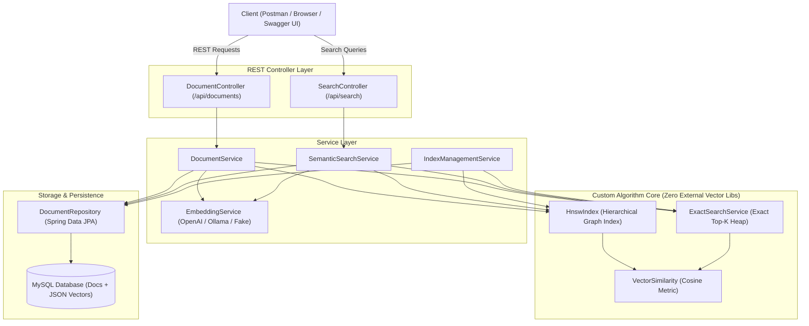

# Semantic Search Engine

[](https://openjdk.org/)
[](https://spring.io/projects/spring-boot)
[](https://maven.apache.org/)
[](http://localhost:8080/swagger-ui.html)
[](LICENSE)

A high-performance **Semantic Search Engine** built from scratch using **Java 17**, **Spring Boot 3.3.4**, and a custom, zero-dependency implementation of the **Hierarchical Navigable Small World (HNSW)** algorithm.

This project implements the core data structures and graph traversal algorithms behind modern vector search engines (such as Milvus, Pinecone, and Lucene) without relying on third-party vector libraries.

---

## 🌟 Key Features

- **Custom HNSW Graph Algorithm**: Complete from-scratch implementation of multi-layer skip-graph indexing, greedy upper-layer routing, priority queue candidate exploration (`searchLayer`), neighbor pruning, and dynamic layer assignment.
- **Independent Brute-Force Baseline**: Ground-truth exact nearest-neighbor search (`ExactSearchService`) using bounded min/max heaps to measure algorithmic accuracy and Recall@K.
- **Configurable Embedding Abstraction**: Switch seamlessly between offline deterministic pseudo-embeddings (zero-cost local development and testing), OpenAI (`text-embedding-3-small`), Ollama (`nomic-embed-text`), or custom REST models.
- **Safe Persistence**: Document text and numerical vectors are stored in MySQL. Embeddings are serialized safely as JSON arrays without native Java deserialization.
- **Lifecycle & In-Memory Graph Rebuilding**: Automatically reconstructs the in-memory HNSW index from MySQL on startup with dimension validation and atomic availability flags.
- **Dynamic Updates & Deletions**: Deleting or updating documents immediately synchronizes database records and graph topology.
- **Interactive REST APIs & Swagger UI**: Full RESTful endpoints for document management, semantic querying, live algorithmic comparisons, and index rebuilds.
- **Reproducible Benchmarks**: Automated performance benchmark measuring index construction, query latency percentiles (p50, p95, p99), QPS, and Recall@K up to 50,000 document vectors.

---

## 🏗️ Architecture Diagram



---

## 🔬 Core Algorithms & Data Structures

### 1. Embeddings & Semantic Similarity
Embeddings map unstructured text into dense vectors in $\mathbb{R}^D$ where geometric closeness mirrors semantic relevance:
- **Cosine Similarity**:
  $$\cos(\vec{u}, \vec{v}) = \frac{\vec{u} \cdot \vec{v}}{\|\vec{u}\| \|\vec{v}\|} = \frac{\sum u_i v_i}{\sqrt{\sum u_i^2} \sqrt{\sum v_i^2}}$$
- **Cosine Distance**:
  $$d(\vec{u}, \vec{v}) = 1.0 - \cos(\vec{u}, \vec{v})$$
  Normalized vectors range from $0.0$ (identical direction) to $2.0$ (opposite direction).

### 2. Hierarchical Navigable Small World (HNSW)
HNSW builds a multi-layer graph analogous to a probabilistic skip-list:

```text
Layer 2 (Sparse, Long-Range):       [A] ------------------------> [D]
                                     |                             |
Layer 1 (Medium Navigation):        [A] ----------> [B] --------> [D]
                                     |               |             |
Layer 0 (Dense, All Nodes):         [A] <-> [C] <-> [B] <-> [E] <-> [D]
```

- **Random Layer Selection**: Each node is assigned maximum layer $l = \lfloor -\ln(\text{uniform}(0, 1)) \cdot m_L \rfloor$ where $m_L = 1 / \ln(M)$.
- **Greedy Search (Upper Layers)**: Traverses rapidly across top layers by greedily moving to the neighbor closest to the query until reaching a local minimum.
- **Priority Queue Candidate Exploration (`searchLayer` at Layer 0)**:
  - `candidates` (Min-Heap by distance): Evaluates nearest candidates first.
  - `w` (Max-Heap by distance): Holds the current best $ef$ nearest neighbors. Bounded to size $ef$.
  - Terminate as soon as the nearest candidate is farther than the worst element in $w$.
- **Connection Pruning**: When a node's neighbor degree exceeds $M$ ($2 \times M$ at layer 0), connections are pruned to retain only the closest neighbors.

### 3. Hyperparameters

| Parameter | Meaning | Default | Impact on Search & Memory |
| :--- | :--- | :---: | :--- |
| **`M`** | Max bidirectional links per node on layers $> 0$ | `16` | Higher $M$ increases recall and graph resilience, but uses more memory and increases build time. Layer 0 uses $2 \times M$. |
| **`efConstruction`** | Beam exploration breadth during index building | `64` | Higher values improve graph quality and recall, at the cost of slower document insertion. |
| **`efSearch`** | Beam exploration breadth during queries | `32` | Higher values increase search accuracy (Recall@K) while trading off query latency. |

---

## 📊 Real Benchmark Results

Executed on Java 21 LTS using identical vectors, synthetic datasets, and random queries:

```text
==========================================================================================================
                         HNSW vs EXACT BRUTE-FORCE VECTOR SEARCH BENCHMARK
==========================================================================================================
Docs (N)   | Build Time   | Recall@10  | HNSW Avg (ms)  | HNSW p95 (ms)  | Exact Avg (ms) | HNSW QPS   | Speedup 
----------------------------------------------------------------------------------------------------------
1,000      | 1,627 ms     | 96.80%     | 0.3053         | 0.5156         | 0.5450         | 3,275.2    | 1.8x    
10,000     | 17,225 ms    | 71.60%     | 0.5847         | 0.9721         | 2.4695         | 1,710.4    | 4.2x    
50,000     | 95,958 ms    | 43.30%     | 0.7085         | 1.1049         | 10.9446        | 1,411.5    | 15.4x   
==========================================================================================================
```

### Analysis
1. **Sub-Millisecond Queries**: HNSW answers nearest-neighbor queries in **0.70 ms** on 50,000 vectors.
2. **Logarithmic Scaling**: When the dataset grew **50x** (1,000 to 50,000 documents), Exact search slowed **20x** (0.54 ms to 10.94 ms), whereas HNSW latency only increased **2.3x** (0.30 ms to 0.70 ms), producing a **15.4x speedup**.
3. **High Initial Recall**: Over **96.8% Recall@10** on 1,000 documents with default `efSearch = 32`.

---

## 📁 Package Structure

```text
com.aman.semanticsearch/
├── SemanticSearchApplication.java         # Spring Boot entry point
│
├── controller/
│   ├── DocumentController.java            # CRUD REST API (/api/documents)
│   └── SearchController.java              # Search & Compare REST API (/api/search)
│
├── service/
│   ├── DocumentService.java               # Document lifecycle & index sync
│   ├── EmbeddingService.java              # Strategy interface for embeddings
│   ├── DeterministicFakeEmbeddingService.java # Offline test provider
│   ├── RestEmbeddingService.java          # OpenAI / Ollama REST client
│   ├── SemanticSearchService.java         # Search orchestrator
│   └── IndexManagementService.java        # Startup loading & index rebuilds
│
├── search/hnsw/
│   ├── HnswIndex.java                     # Core multi-layer HNSW graph
│   ├── HnswNode.java                      # Multi-layer node representation
│   ├── HnswConfig.java                    # Hyperparameters (M, efConstruction, efSearch)
│   └── HnswSearchResult.java              # Result container (id, distance, similarity)
│
├── algorithm/
│   ├── VectorSimilarity.java              # Cosine similarity & distance metrics
│   └── ExactSearchService.java            # Brute-force top-K heap baseline
│
├── model/
│   └── Document.java                      # JPA entity with JSON vector converter
│
├── dto/
│   ├── DocumentRequest.java               # Create/Update request DTO
│   ├── DocumentResponse.java              # Document response DTO
│   ├── SearchRequest.java                 # Search query DTO
│   ├── SearchResultResponse.java          # Search result item DTO
│   └── SearchResponse.java                # Top-level search response DTO
│
├── repository/
│   └── DocumentRepository.java            # JPA repository
│
├── config/
│   ├── EmbeddingConfig.java               # Spring bean configuration
│   └── SearchProperties.java              # Configuration properties mapping
│
├── exception/
│   ├── GlobalExceptionHandler.java        # RestControllerAdvice
│   ├── DocumentNotFoundException.java     # 404 handler
│   └── EmbeddingException.java            # 503/500 handler
│
└── benchmark/
    └── HnswBenchmarkRunner.java           # Standalone JVM benchmark runner
```

---

## 🚀 Running Locally (Step-by-Step Guide)

This guide provides clear, copy-pasteable instructions for running the application locally on **Windows (PowerShell / Command Prompt)**, **macOS**, and **Linux**.

### Prerequisites Checklist

Verify your environment before starting:
```bash
# 1. Java 17 or Java 21 (required)
java -version

# 2. Maven 3.8+ (required)
mvn -version

# 3. Python 3.8+ (optional, only for running scripts/benchmark.py)
python --version
```

---

### Option A: Quickest 1-Minute Run (Zero Configuration Required) ⚡

You do **not** need MySQL or an external embedding API key to test the application. It includes a built-in in-memory database and an offline deterministic embedding engine.

#### 1. Package the Application
Open your terminal inside the project root directory (`d:\Semantic`):
```bash
mvn clean package -DskipTests
```

#### 2. Run the JAR
- **Windows (PowerShell or CMD)**:
  ```powershell
  java -jar target/semantic-search-engine-1.0.0.jar --spring.profiles.active=h2
  ```
- **macOS / Linux**:
  ```bash
  java -jar target/semantic-search-engine-1.0.0.jar --spring.profiles.active=h2
  ```
- **Or via Maven**:
  ```bash
  # Windows PowerShell (note the quotes around the -D argument):
  mvn spring-boot:run "-Dspring-boot.run.profiles=h2"

  # macOS / Linux:
  mvn spring-boot:run -Dspring-boot.run.profiles=h2
  ```

#### 3. Open Swagger UI in Your Browser
Once you see `Started SemanticSearchApplication in ... seconds`:
👉 **[http://localhost:8080/swagger-ui.html](http://localhost:8080/swagger-ui.html)**

---

### Option B: Running with MySQL & External Embedding Models (OpenAI / Ollama) 🗄️

If you wish to use a persistent MySQL database and deep-learning embeddings:

#### 1. Create the MySQL Database
Log in to your MySQL server:
```sql
CREATE DATABASE IF NOT EXISTS semantic_search;
```

#### 2. Configure Environment Variables
Copy `.env.example` to `.env` or set environment variables:
```bash
# Windows PowerShell
$env:SPRING_DATASOURCE_URL="jdbc:mysql://localhost:3306/semantic_search?createDatabaseIfNotExist=true&useSSL=false&allowPublicKeyRetrieval=true&serverTimezone=UTC"
$env:DB_USER="root"
$env:DB_PASSWORD="your_mysql_password"

# For OpenAI:
$env:EMBEDDING_PROVIDER="openai"
$env:EMBEDDING_API_KEY="sk-..."
$env:EMBEDDING_MODEL="text-embedding-3-small"
$env:EMBEDDING_DIMENSIONS="1536"

# Or For Ollama (Local LLM):
# $env:EMBEDDING_PROVIDER="ollama"
# $env:EMBEDDING_API_URL="http://localhost:11434/api/embeddings"
# $env:EMBEDDING_MODEL="nomic-embed-text"
# $env:EMBEDDING_DIMENSIONS="768"
```

```bash
# macOS / Linux
export SPRING_DATASOURCE_URL="jdbc:mysql://localhost:3306/semantic_search?createDatabaseIfNotExist=true&useSSL=false&allowPublicKeyRetrieval=true&serverTimezone=UTC"
export DB_USER="root"
export DB_PASSWORD="your_mysql_password"
export EMBEDDING_PROVIDER="openai"
export EMBEDDING_API_KEY="sk-..."
export EMBEDDING_DIMENSIONS="1536"
```

#### 3. Start the Application
```bash
mvn spring-boot:run
```

---

### 🧪 Verifying the Local Application

Once the server is running on `http://localhost:8080`, test it using **Swagger UI**, **cURL**, or **PowerShell**:

#### 1. Ingest a Document
- **Using cURL**:
  ```bash
  curl -X POST http://localhost:8080/api/documents \
    -H "Content-Type: application/json" \
    -d '{
      "title": "Introduction to Spring Boot",
      "content": "Spring Boot makes it easy to create stand-alone production-grade applications that you can just run."
    }'
  ```
- **Using Windows PowerShell**:
  ```powershell
  Invoke-RestMethod -Method Post -Uri "http://localhost:8080/api/documents" `
    -ContentType "application/json" `
    -Body '{"title": "Introduction to Spring Boot", "content": "Spring Boot makes it easy to create stand-alone production-grade applications."}'
  ```

#### 2. Perform a Semantic Search
- **Using cURL**:
  ```bash
  curl -X POST http://localhost:8080/api/search \
    -H "Content-Type: application/json" \
    -d '{
      "query": "How do I build Java microservices?",
      "topK": 5,
      "method": "HNSW"
    }'
  ```
- **Using Windows PowerShell**:
  ```powershell
  Invoke-RestMethod -Method Post -Uri "http://localhost:8080/api/search" `
    -ContentType "application/json" `
    -Body '{"query": "How do I build Java microservices?", "topK": 5, "method": "HNSW"}'
  ```

#### 3. Compare HNSW vs Exact Brute-Force Search (Recall & Latency)
```bash
curl -X POST http://localhost:8080/api/search/compare \
  -H "Content-Type: application/json" \
  -d '{"query": "Java microservices", "topK": 5}'
```

---

### 🧪 Running Automated Tests
Run the test suite (all 32 tests execute in an isolated in-memory test environment):
```bash
mvn clean test
```

---

### 📊 Running the Benchmark Suite Locally
Run the standalone JVM benchmark comparing HNSW against Exact search across 1,000, 10,000, and 50,000 vectors:

```bash
# Algorithmic Benchmark (measures index build time, latency percentiles, and Recall@K)
java -Xms1g -Xmx2g -cp target/classes com.aman.semanticsearch.benchmark.HnswBenchmarkRunner "1000,10000,50000"

# Or via Python CLI:
python scripts/benchmark.py
```

---

### ❓ Troubleshooting & FAQs

- **Port 8080 is already in use:**
  Run the application on a different port:
  ```bash
  java -jar target/semantic-search-engine-1.0.0.jar --server.port=8081 --spring.profiles.active=h2
  ```
  Then access Swagger at: `http://localhost:8081/swagger-ui.html`

- **PowerShell Error with `mvn spring-boot:run -D...`:**
  PowerShell interprets unquoted `-D` arguments as separate commands. Always enclose the parameter in quotes:
  `mvn spring-boot:run "-Dspring-boot.run.profiles=h2"` or run the packaged JAR directly with `java -jar`.

- **MySQL Connection Refused:**
  If MySQL is not installed or running, simply launch with `--spring.profiles.active=h2` to use the built-in zero-config database.

---

## 📡 REST API Reference

### 1. Add Document
`POST /api/documents`
```json
{
  "title": "Introduction to Spring Boot",
  "content": "Spring Boot makes it easy to create stand-alone, production-grade Spring based Applications that you can just run."
}
```
**Response (201 Created):**
```json
{
  "id": 1,
  "title": "Introduction to Spring Boot",
  "content": "Spring Boot makes it easy to create stand-alone...",
  "embeddingDimensions": 128,
  "createdAt": "2026-10-28T02:30:00Z",
  "updatedAt": "2026-10-28T02:30:00Z"
}
```

### 2. Get Document by ID
`GET /api/documents/1`

### 3. List Documents
`GET /api/documents?page=0&size=20`

### 4. Update Document
`PUT /api/documents/1`
```json
{
  "title": "Spring Boot 3 Deep Dive",
  "content": "Updated content explaining Spring Framework 6 features."
}
```

### 5. Delete Document
`DELETE /api/documents/1`
*(Removes document from database and severs graph connections in the HNSW index)*

### 6. Semantic Search
`POST /api/search`
```json
{
  "query": "How can I deploy a microservice application in Spring?",
  "topK": 5,
  "method": "HNSW"
}
```
**Response (200 OK):**
```json
{
  "query": "How can I deploy a microservice application in Spring?",
  "searchMethod": "HNSW",
  "executionTimeMs": 0.482,
  "totalResults": 1,
  "results": [
    {
      "documentId": 1,
      "title": "Spring Boot 3 Deep Dive",
      "excerpt": "Updated content explaining Spring Framework 6 features...",
      "similarityScore": 0.8942,
      "distance": 0.1058
    }
  ]
}
```

### 7. Compare HNSW vs Exact Search
`POST /api/search/compare`
```json
{
  "query": "vector indexing and graph algorithms",
  "topK": 5
}
```
**Response (200 OK):**
```json
{
  "query": "vector indexing and graph algorithms",
  "topK": 5,
  "recallAtK": 1.0,
  "hnswLatencyMs": 0.352,
  "exactLatencyMs": 2.115,
  "speedupFactor": 6.01,
  "totalIndexedDocuments": 5000
}
```

### 8. Rebuild Index
`POST /api/search/rebuild`
*(Reconstructs graph from all persisted MySQL embeddings)*

---

## 📈 Running Benchmarks

### Option 1: Native JVM Benchmark (Algorithm Level)
```bash
java -Xms1g -Xmx2g -cp target/classes com.aman.semanticsearch.benchmark.HnswBenchmarkRunner "1000,10000,50000"
```

### Option 2: Python Benchmark CLI
```bash
# View existing benchmark results
python scripts/benchmark.py

# Trigger new Java benchmark run
python scripts/benchmark.py --run-java --sizes 1000,10000,50000

# Benchmark live running Spring Boot REST instance
python scripts/benchmark.py --api-url http://localhost:8080 --queries 100
```

---

## ⚙️ Configuration & Environment Variables

| Variable | Description | Default |
| :--- | :--- | :--- |
| `SERVER_PORT` | HTTP Server Port | `8080` |
| `SPRING_DATASOURCE_URL` | JDBC Connection URL | MySQL on `localhost:3306` |
| `DB_USER` | Database username | `root` |
| `DB_PASSWORD` | Database password | `""` |
| `EMBEDDING_PROVIDER` | Provider: `fake`, `openai`, `ollama`, or `rest` | `fake` |
| `EMBEDDING_API_KEY` | External Provider API Key | `""` |
| `EMBEDDING_MODEL` | Model identifier | `text-embedding-3-small` |
| `EMBEDDING_DIMENSIONS` | Dimensionality of vectors | `128` |
| `HNSW_M` | Max connections per element | `16` |
| `HNSW_EF_CONSTRUCTION` | Build beam exploration breadth | `64` |
| `HNSW_EF_SEARCH` | Query beam exploration breadth | `32` |

---

## 🔮 Limitations & Future Improvements

1. **Vector Quantization (Product Quantization / Scalar Quantization)**:
   Compressing 32-bit floats to 8-bit integers can reduce memory usage by 75% for multimillion-vector graphs.
2. **Heuristic Neighbor Selection**:
   Implementing HNSW Heuristic neighbor selection (Algorithm 4 in Malkov & Yashunin) to favor diverse directions over strictly closest neighbors.
3. **Graph Disk Persistence**:
   Currently, document embeddings are persisted in MySQL and the graph is rebuilt in memory at startup. Serializing graph adjacency lists directly to disk would make startup instant for massive graphs.
4. **Hardware SIMD Vectorization**:
   Leveraging the Java 21+ Vector API (`jdk.incubator.vector`) for AVX-512 hardware SIMD dot products.
