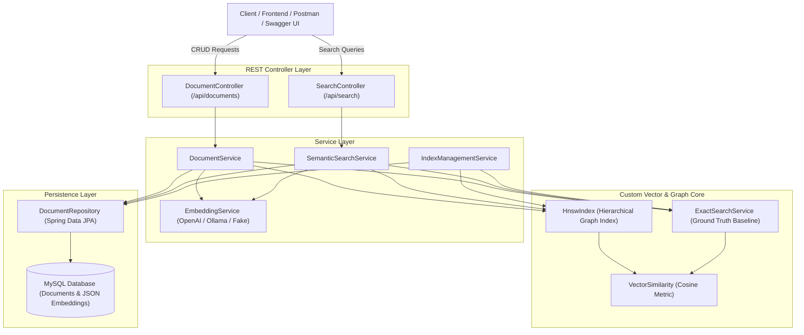

# Semantic Search Engine Architecture & Design Specification

This document provides a technical explanation of the architecture, data structures, algorithms, persistence strategies, and concurrency decisions powering the **Semantic Search Engine** with custom **HNSW (Hierarchical Navigable Small World)** vector indexing.

---

## 1. System Overview & Architecture

The system is organized into modular layers adhering to clean architecture and separation of concerns:

---

## 2. Ingestion & Indexing Pipeline

When a document is submitted via `POST /api/documents`:

1. **Validation & Extraction**:
   - `DocumentRequest` is validated (`@NotBlank` title and content).
   - Searchable text is formatted as `title + "\n\n" + content`.

2. **Embedding Generation**:
   - Text is passed to `EmbeddingService.generateEmbedding(text)`.
   - The provider converts text into a high-dimensional normalized vector (e.g., $D=128$ or $D=1536$).
   - The returned vector is validated to ensure non-empty, finite floats with no `NaN` or `Infinity`.

3. **Persistence (MySQL)**:
   - The `Document` entity is saved via `DocumentRepository`.
   - The embedding vector is serialized safely as a JSON array (via Jackson `FloatArrayJsonConverter`).
   - Standard numeric JSON ensures database portability without relying on unsafe Java native deserialization.

4. **In-Memory Graph Insertion**:
   - The document ID and vector are inserted into `HnswIndex`:
     - Assign random layer level $l \sim \lfloor -\ln(u) \cdot mL \rfloor$.
     - Perform greedy top-down routing through upper layers ($currentMaxLayer \dots l + 1$).
     - Explore candidates at lower layers ($l \dots 0$) using beam search bounded by `efConstruction`.
     - Select up to $M$ closest neighbors and establish bidirectional edges.
     - Prune neighbor degrees if exceeding $M_{max}$ ($2 \times M$ at layer 0).
   - Simultaneously indexed into `ExactSearchService` for brute-force benchmarking.

---

## 3. Query Pipeline

When a natural-language search query is submitted via `POST /api/search`:

1. **Query Ingestion**:
   - Validates query text and $topK$ parameter ($1 \le topK \le 100$).
   - Verifies `IndexManagementService.isReady()` to ensure indexing isn't mid-initialization.

2. **Query Vectorization**:
   - Converts the query into an embedding vector using the identical model and dimensionality.

3. **Graph Search Execution**:
   - If `method == "HNSW"`:
     - Starts from the global entry point at `maxLayer`.
     - **Greedy Upper-Layer Search**: Steps along nearest neighbor links until a local minimum is reached at layer 1.
     - **Layer 0 Beam Search**: Explores candidates with beam width $ef = \max(efSearch, topK)$ using a min-heap candidate queue and a bounded max-heap result queue.
     - Returns top-$K$ approximate nearest neighbors sorted by distance ascending.
   - If `method == "EXACT"`:
     - Performs a full linear scan over all vectors in memory using a bounded max-heap of size $K$.

4. **Document Hydration & Scoring**:
   - Document metadata (title, content excerpt) is fetched from `DocumentRepository.findAllById(ids)`.
   - Excerpts are formatted with cosine similarity scores $s = 1.0 - d$.
   - Structured `SearchResponse` is returned to client.

---

## 4. Custom HNSW Graph Structure & Mathematical Principles

### Metric Foundations
- **Cosine Similarity**:
  $$\cos(\vec{u}, \vec{v}) = \frac{\vec{u} \cdot \vec{v}}{\|\vec{u}\| \|\vec{v}\|} = \frac{\sum_{i=1}^D u_i v_i}{\sqrt{\sum_{i=1}^D u_i^2} \sqrt{\sum_{i=1}^D v_i^2}}$$
- **Cosine Distance**:
  $$d(\vec{u}, \vec{v}) = 1.0 - \cos(\vec{u}, \vec{v})$$
  - Range: $[0.0, 2.0]$.
  - $0.0 \implies$ identical direction.
  - $1.0 \implies$ orthogonal.
  - $2.0 \implies$ diametrically opposite.
  - Monotonically decreases as similarity increases, allowing standard priority queue min-heaps to find the most similar documents.

### Multi-Layer Hierarchy & Probabilistic Layer Assignment
HNSW acts as a multi-dimensional analogue of a skip-list:
- Top layers contain sparse nodes with long-range links for coarse navigation ($O(\log N)$).
- Layer 0 contains all nodes and dense local connections for high recall.
- Level assignment formula:
  $$l = \left\lfloor -\ln(\text{uniform}(0, 1)) \cdot m_L \right\rfloor \quad \text{where } m_L = \frac{1}{\ln(M)}$$

### Priority Queue Beam Search (`searchLayer`)
At each target layer, candidate exploration uses two distinct heaps:
- **`candidates` (Min-Heap by distance)**: Determines which candidate node to explore next. Nearest candidate is polled first.
- **`w` (Max-Heap by distance)**: Tracks the best discovered nearest neighbors, strictly bounded to size $ef$. The worst element is at the top of the heap.
- **Early Exit**: If the nearest candidate in `candidates` is farther than the worst element in `w`, exploration terminates because no unvisited neighbor can improve `w`.

### Degree Pruning
To prevent graph density from exploding:
- When connecting a new node to neighbors, if any neighbor's connection count exceeds $M$ (or $2 \times M$ at layer 0), connections are re-evaluated and pruned to keep only the closest $M$ neighbors.

---

## 5. Concurrency & Thread-Safety Decisions

1. **Reader-Writer Locking (`ReentrantReadWriteLock`)**:
   - Vector searches take the shared read lock (`rwLock.readLock()`). Multiple search queries execute concurrently without contention.
   - Insertions, deletions, and updates take the exclusive write lock (`rwLock.writeLock()`).
2. **Fairness**:
   - `new ReentrantReadWriteLock(true)` prevents write starvation under heavy search traffic.
3. **Internal Node Collections**:
   - Graph neighbor sets are held in `LinkedHashSet<Long>` within `HnswNode`. Lookups and removals are $O(1)$ and iteration order is deterministic.

---

## 6. Persistence & Startup Rebuild Lifecycle

1. **Startup Initialization**:
   - Spring Boot fires `ApplicationReadyEvent`.
   - `IndexManagementService` loads all documents with embeddings from MySQL (`findAllWithEmbedding()`).
   - Dimensions are validated across all records.
   - Graph index and exact store are populated in-memory.
   - `ready` atomic flag is set to `true`.
2. **Safety**:
   - Search requests before initialization completes are rejected with a clean HTTP 503 / 400 error rather than returning partial results.
3. **Rebuild API**:
   - `POST /api/search/rebuild` allows re-indexing without restarting the Spring Boot JVM.
